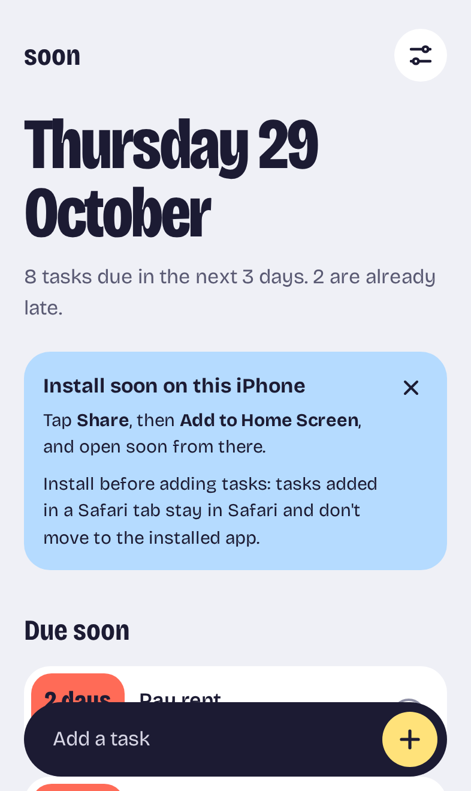
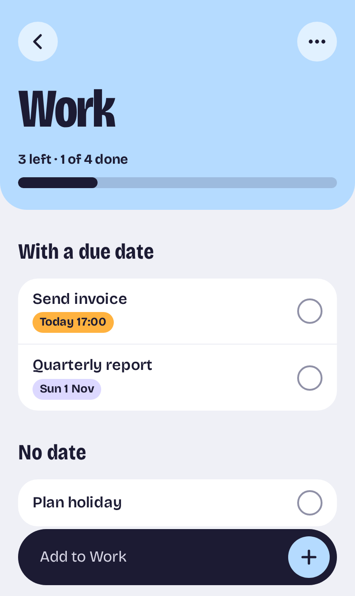
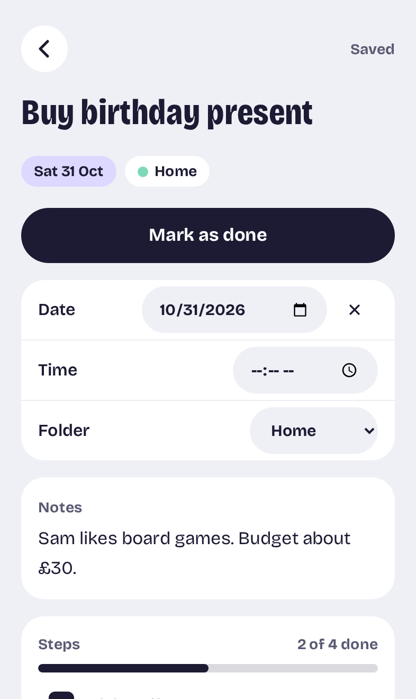
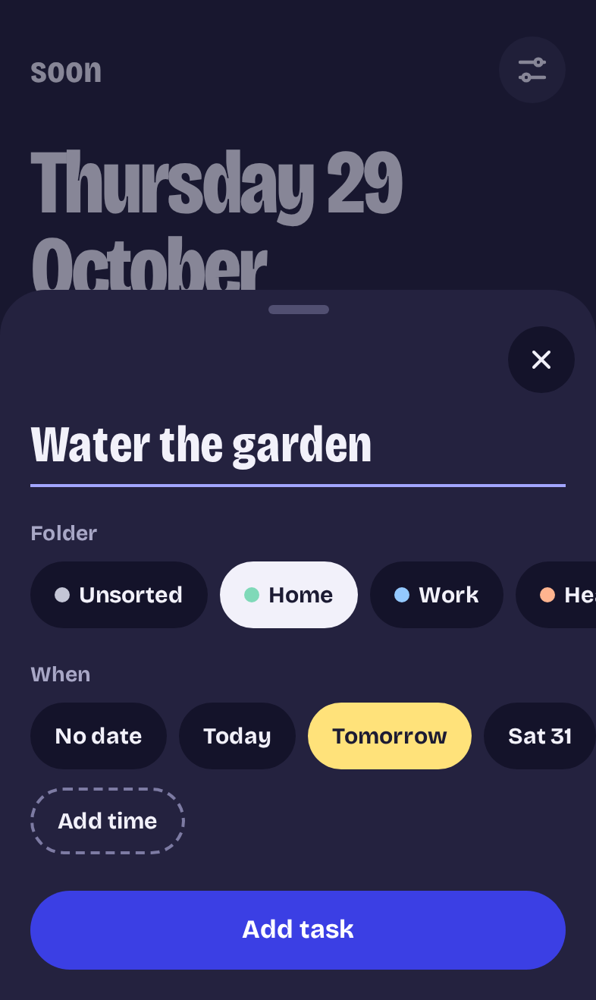

# soon

soon is a task manager for your phone that puts what's due next at the top. You install it from the browser on iPhone or Android. It works offline and keeps everything on the phone. There's no account and no server.

Try it: https://soon.yunnna.workers.dev

On a computer that link shows install steps and a QR code to scan with your phone. There's also a link to try it in the browser.

<p>
  
  
  
  
</p>

## What it does

- Home shows today's date, then "Due soon": anything overdue plus anything due in the next 1 to 7 days (you pick the number in Settings). Below that are your folders.
- Due soon cards are coloured by how close they are. Coral is late, amber is today, yellow is tomorrow and lilac is later.
- Folders have a colour and a progress bar. Unsorted is the inbox and catches anything without a folder.
- The quick add sheet stays open after each task, so you can add a few in a row. You pick the folder and day with chips, and a time if you want one.
- Each task has notes, a checklist of steps, a date and an optional time. Changes save as you type.
- Ticking off or deleting a task shows an Undo button for about five seconds.
- Finished tasks from every folder go into a Completed folder, which you can clear in one go.
- There's a light theme, a dark theme, or it follows the phone.
- You can export a backup file and import it again, on the same phone or a new one. Import checks the whole file before it changes anything.

There are no reminders or notifications yet. A due time is shown, but nothing goes off.

## Privacy

Tasks are stored in IndexedDB in your browser and nothing is sent anywhere. There are no analytics and no third-party scripts, and the Content-Security-Policy only lets the page load files from its own address. Your data leaves the phone only when you export a backup.

One thing to know on iPhone: Safari and the installed app keep separate data, so install it before you add tasks. The app shows a hint about this the first time you open it in Safari.

## Built with

- React, TypeScript and Vite
- Tailwind CSS
- Dexie and dexie-react-hooks for IndexedDB
- vite-plugin-pwa (Workbox) for the service worker and offline support
- uqr for the QR code on the desktop page
- Bricolage Grotesque, served from the app itself rather than Google Fonts
- Vitest, Testing Library and fake-indexeddb for unit tests
- Playwright for end-to-end tests in Chromium and WebKit, at desktop, Pixel 7 and iPhone 15 sizes
- Cloudflare Workers static assets for hosting

There's no router or state library. Screens use hash routes (`#/folder/<id>`, `#/task/<id>`) and read data straight from IndexedDB with live queries.

## Running it

You'll need Node.js. I use version 24.

```
npm install
npm run dev
```

That starts the app at http://localhost:3000. Open http://localhost:3000/?seed to fill it with sample tasks. This only works in development and test builds.

Other commands:

```
npm test              # unit tests
npm run test:e2e      # end-to-end tests (builds the app first)
npm run lint
npm run typecheck
npm run build         # production build in dist/
npm run deploy        # build, then deploy to Cloudflare
```

Before the first `npm run test:e2e` on a new machine, install the browsers with `npx playwright install --with-deps chromium webkit`.

## Project layout

```
src/
  db/          all IndexedDB code: tasks, folders, settings, backups
  lib/         dates and urgency, routing, toasts, copy
  screens/     Home, Folder, Task, Completed, Settings, DesktopLanding
  components/  cards, tiles, sheets, chips and other pieces
  pwa/         service worker updates, install hint, storage
tests/e2e/     Playwright tests
docs/          iPhone test checklist and screenshots
```

The date and urgency logic in `src/lib/dates.ts` has its own tests, including the seconds around midnight, clock changes and a time zone where midnight is skipped.

`DESIGN.md` has the design spec and `CLAUDE.md` has the agreed behaviour and decisions.

## Credits

The typeface is Bricolage Grotesque, used under the SIL Open Font License and installed from Fontsource.

Made by Anna Kovalenko.
